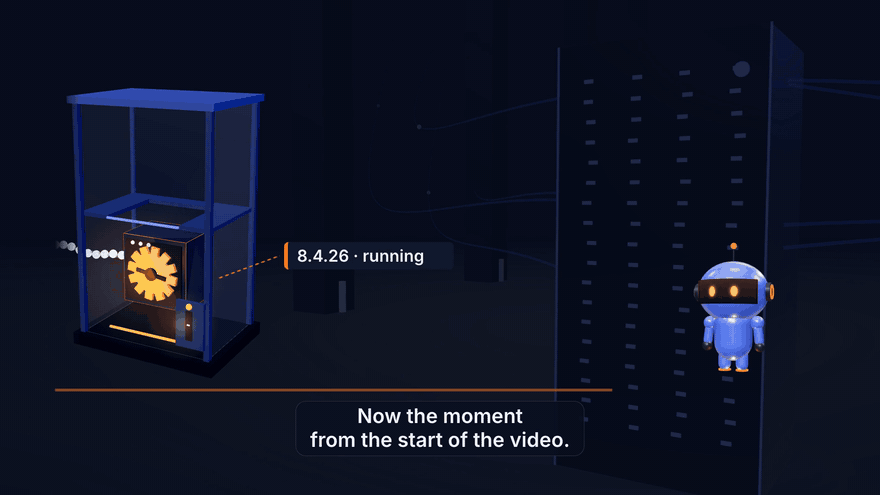

# php2shell-lab

[](https://github.com/qualixar/php2shell-lab/actions/workflows/ci.yml)
[](LICENSE)

**Downloaded the PHP fix and still vulnerable? This lab shows why in two minutes, on your own machine, with no exploit code.**

PHP2Shell is the name given to CVE-2026-109618 and CVE-2026-109619, two critical bugs in PHP itself (CVSS 9.2), fixed on 21 October 2026 in PHP 8.5.12, 8.4.27, 8.3.36 and 8.2.35. A third issue, CVE-2026-115560, also affects the fixed releases and has no fix release yet; PHP's interim advice is `session.upload_progress.enabled = 0`.

The trap this lab is about: a package on disk does not change a process that is already running. Your PHP workers keep serving the old code until they restart. Until then, the server answers as vulnerable even though the update "succeeded".



This repository is the lab from the film **[PHP2Shell: Patched PHP Can Still Be Vulnerable (Here's Why)](https://youtu.be/VzMjup_p0f0)** on the Qualixar AI YouTube channel (22 minutes: the week it broke, the lab, and the loop to work through tonight).

---

## What is in here

| File | What it does |
|---|---|
| `docker-compose.yml` | Two official `php:*-apache` containers, bound to `127.0.0.1` only: **legacy** (8.4.26, the last build before the fix) on `:8081` and **patched** (8.4.27, interim setting applied) on `:8082`. |
| `www/runtime.php` | A three-field probe that reports what the **web** interpreter runs: version, SAPI, upload-progress setting. Lab only. |
| `php2shell-check.sh` | Asks the web runtime (not your shell's `php -v`) which PHP serves requests and compares it with the fixed release for that branch. |
| `scripts/restart-trap-demo.sh` | The restart trap, step by step: pull the fix, check (still vulnerable), restart, check (patched). Fails loudly if any step behaves differently. |
| `scripts/hunt.sh` | A read-only first look on a host that ran a vulnerable build: changed files since 17 Oct, every POST in the current and rotated access logs (front controllers hide `.php` in the URI), session files in PHP's real `session.save_path`, and shells, interpreters or download tools running as the web-server user. |
| `tests/parse-test.sh` | Offline tests for the check script: pretty and compact JSON, Surý and Debian build strings, EOL branches, an unreadable probe. |
| `.github/workflows/ci.yml` | Boots both runtimes on every push and proves the lab: legacy must exit `1` (VULNERABLE), patched must exit `0` (PATCHED), the restart trap must reproduce end to end. |

## Run it

Needs Docker with Compose v2. Everything listens on loopback only.

```bash
git clone https://github.com/qualixar/php2shell-lab && cd php2shell-lab
make up      # start legacy (:8081) and patched (:8082)
make check   # ask each web runtime which PHP it serves
make demo    # the restart trap, step by step
make hunt    # read-only first look at the legacy container
make down    # clean up
```

What you should see (captured from the lab on 26 Oct 2026):

```text
$ ./php2shell-check.sh http://127.0.0.1:8081/runtime.php
web runtime : PHP 8.4.26 (apache2handler)
PHP2Shell   : VULNERABLE (needs 8.4.27)
upload prog : on (set session.upload_progress.enabled=0 until the next release)

$ LEGACY_TAG=8.4.27-apache docker compose pull -q legacy && echo 'patched image downloaded'
patched image downloaded

$ ./php2shell-check.sh http://127.0.0.1:8081/runtime.php
web runtime : PHP 8.4.26 (apache2handler)
PHP2Shell   : VULNERABLE (needs 8.4.27)          <- the fix is on disk, the old process still answers

$ LEGACY_TAG=8.4.27-apache docker compose up -d legacy && sleep 3

$ ./php2shell-check.sh http://127.0.0.1:8081/runtime.php
web runtime : PHP 8.4.27 (apache2handler)
PHP2Shell   : PATCHED (>= 8.4.27)
```

Exit codes from `php2shell-check.sh`: `0` patched, `1` vulnerable, `2` end-of-life branch (8.1 and older have no official release: vendor backport, upgrade, or take it offline), `3` the probe could not be read. It reads compact or pretty-printed JSON and compares only the upstream part of distro build strings such as `8.4.27-1+ubuntu24.04.1+deb.sury.org+1`; `make test` runs the parser against those cases offline.

## On a real server

The lab restarts a container. On a real server the same step is restarting whatever runs PHP for the web, after the update:

```bash
sudo apt-get install --only-upgrade 'php8.4*'   # Debian/Ubuntu: upgrade the whole php8.4 set, not one package
sudo systemctl restart php8.4-fpm     # PHP-FPM (nginx and most modern stacks; use your version's unit name)
sudo systemctl restart apache2        # Apache with mod_php (httpd on RHEL-family systems)
docker compose up -d --build          # containers: rebuild from the patched image, don't just pull it
```

Google's guidance says it in so many words: explicitly restart PHP-FPM, Apache, FrankenPHP or LiteSpeed after you update, or the old code keeps running.

Then confirm what the **web** runtime reports, not what `php -v` says in your terminal. The CLI and the web server can run different builds. Two safe ways:

- **OpenAI's [php2shell-checker](https://github.com/openai/php2shell-checker)** reads what your site advertises in its headers and sends no exploit probes. Its own README states the limit: headers can be hidden or missing.
- **This repo's probe:** put `www/runtime.php` on the site for one minute, run `./php2shell-check.sh https://your-site/runtime.php`, then **delete the probe**.

Distribution packages (Debian, Ubuntu, RHEL) often backport the fix under an older version number, so a `VULNERABLE` result on a distro build means "check your vendor's advisory", not "definitely exposed".

## The loop the film walks through

1. **Find** every PHP you run: production, staging, old client sites, containers, the control panel, and any application that ships its own PHP.
2. **Check** what each site advertises (checker or probe above).
3. **Decide** before you touch anything: if the box may have been hit, capture worker memory first. A restart permanently destroys that evidence.
4. **Patch with proof:** update, set `session.upload_progress.enabled = 0` for the third issue, restart the workers, then check again.
5. **Hunt** back to 17 October, the earliest reported attempt: `scripts/hunt.sh` is a starting point, not a verdict.
6. **Keep watching:** a hunt is a snapshot. Florian Roth's [process-watcher](https://github.com/Neo23x0/process-watcher) flags a PHP worker spawning a shell or a download tool. The Dutch NCSC keeps an operational [PHP2Shell repository](https://github.com/NCSC-NL/php2shell).

## What this lab is not

It contains no exploit, no payload and no scanner that touches other systems. It tells you which build serves requests; it says nothing about whether anyone already got in. Only run checks against systems you own or are authorised to test.

## Sources

- PHP release announcements: <https://www.php.net/archive/2026.php>
- CISA alert, 21 Oct 2026: <https://www.cisa.gov/news-events/alerts/2026/10/21/critical-vulnerabilities-php-require-immediate-patching>
- OpenAI coordinated disclosure: <https://openai.com/index/coordinated-disclosure-of-critical-vulnerabilities>

## About

Built by [Varun Pratap Bhardwaj](https://github.com/varun369) as part of Qualixar, an independent research initiative on AI Reliability Engineering: checking what systems and models actually do before you trust them. MIT licensed. Issues and pull requests are welcome.
